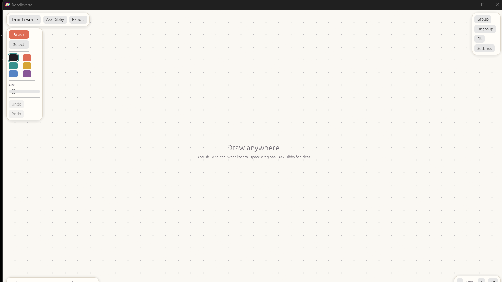

# Doodleverse

A native, local-first whiteboard written in Rust. Infinite canvas, pressure-aware ink,
portable boards, and a small offline AI sketch partner named Dibby — no accounts, no
cloud, no autosave.



## What works today

- **Infinite canvas** with cursor-anchored zoom, space/middle-drag panning, and a bounded
  level-of-detail grid (dots, pluses, lines, or none).
- **Pressure-aware brush.** Mouse strokes simulate pressure from speed and progress. On
  Windows, tablet pen pressure is read from the native pointer stack and applied per sample.
- **Selection and structure.** Marquee/click selection, move, delete, group, ungroup,
  select all, and command-level undo/redo that never records remote CRDT edits.
- **Board theming** with presets and custom colors, grid spacing/opacity/color, dot/plus
  size and line width.
- **Floating Excalidraw-style toolbox** over the canvas, with `Alt+Z` zen mode that hides
  the chrome and leaves only the board.
- **Portable files.** `.doodleverse` export uses a versioned envelope with CRC validation.
  Import validates the whole payload, remaps every identity, and places the board at the
  origin (empty canvas) or as a validated ghost preview (non-empty canvas).
- **Dibby AI cards** that stream answers from a fully offline demo provider, support
  alternatives, cancellation, and pin a single completed answer to the board as a normal
  statement object. Questions and drafts never leave the session.
- **Dibby mascot** animated from the approved atlas and motion manifest, with reduced-motion
  support and a neutral frame fallback.
- **Stateless by design.** Nothing is written unless you export. Closing the window asks
  first and offers export-then-close.

## Run it

Rust is pinned by `rust-toolchain.toml` (1.99.1 with rustfmt and clippy).

```bash
cargo run --release -p doodle-app
```

Checks that gate the repository:

```bash
cargo fmt --all -- --check
cargo clippy --workspace --all-targets --locked -- -D warnings
cargo test --workspace --locked
cargo build --workspace --release --locked
```

For unattended UI runs, `DOODLE_TEST_WINDOW="x,y,w,h"` places the window explicitly so a
test never covers the primary display.

## Controls

| Input | Action |
| --- | --- |
| `B` / `V` | Brush / Select |
| Left drag | Draw, move selection, or marquee |
| `Shift` + click | Toggle selection |
| `Ctrl+A` | Select all top-level objects |
| `Delete` / `Backspace` | Delete selection |
| `Ctrl+G` / `Ctrl+Shift+G` | Group / ungroup selection |
| `Ctrl+Z` / `Ctrl+Y` or `Ctrl+Shift+Z` | Undo / redo |
| Wheel or trackpad scroll | Zoom at cursor |
| Space-drag / middle-drag | Pan |
| `F` / `0` | Fit content / reset view |
| `Alt+Z` | Toggle Excalidraw-style zen mode |
| `Esc` | Cancel stroke, drag, marquee, or pending import |

## The board file

A `.doodleverse` file is a self-contained snapshot of the visible board:

```
magic "DVRSE\0\0\0" | envelope version | schema version | flags
payload length | CRC32(payload) | postcard(BoardSnapshot)
```

Import never trusts a file: size, header, payload length, CRC, schema, object validity,
duplicate IDs, group parents, and depth are all checked before anything is committed.
Imported content is remapped to fresh IDs so two boards can coexist. See
[docs/contracts.md](docs/contracts.md).

## Workspace

| Crate | Role |
| --- | --- |
| `doodle-types` | IDs, geometry, objects, commands, limits, versions |
| `doodle-canvas` | Camera, brush pipeline, stroke geometry, hit tests |
| `doodle-document` | yrs CRDT document, projection, undo history, snapshots |
| `doodle-render` | Grid frames and cached screen-space stroke meshes |
| `doodle-files` | File envelope, validation, ID remapping, atomic writes |
| `doodle-ai` | AI card state machine, provider trait, offline demo provider, mascot |
| `doodle-platform` | Native dialogs, pen pressure, test-window placement |
| `doodle-app` | eframe/egui application shell and canvas UI |

Dependencies point inward: app → render/files/ai/document/canvas → types. See
[docs/architecture.md](docs/architecture.md) for the data flow and invariants.

## Honest limitations

- **Networking is not implemented.** There is no signalling, WebRTC transport, room UI, or
  remote cursor. The CRDT document and update APIs are ready for a transport, but no board
  byte is sent anywhere in this build.
- **AI is an offline demo.** BYOK, ChatGPT sign-in, ACP agents, and the OS credential vault
  are not included. No credentials are stored in any form.
- **Pen pressure is wired on Windows only.** Other platforms use the mouse simulation path
  until native pointer probes land.
- **Packaging/signing** (installer, MSIX, notarization, app-store metadata) is not done; the
  release binary is a plain native executable.
- **Settings are session-only.** Theme, grid, and brush choices reset when the app closes.

These are recorded with rationale and resume steps in [decisions.md](decisions.md).

## Privacy

No telemetry, no accounts, no network calls. Boards live in RAM until you export. The AI
card boundary carries one typed question and an optional short instruction — never the
board, file paths, peer IDs, or conversation history. The Windows pen probe only reads
pointer pressure inside the app window.

## License

MIT OR Apache-2.0.
